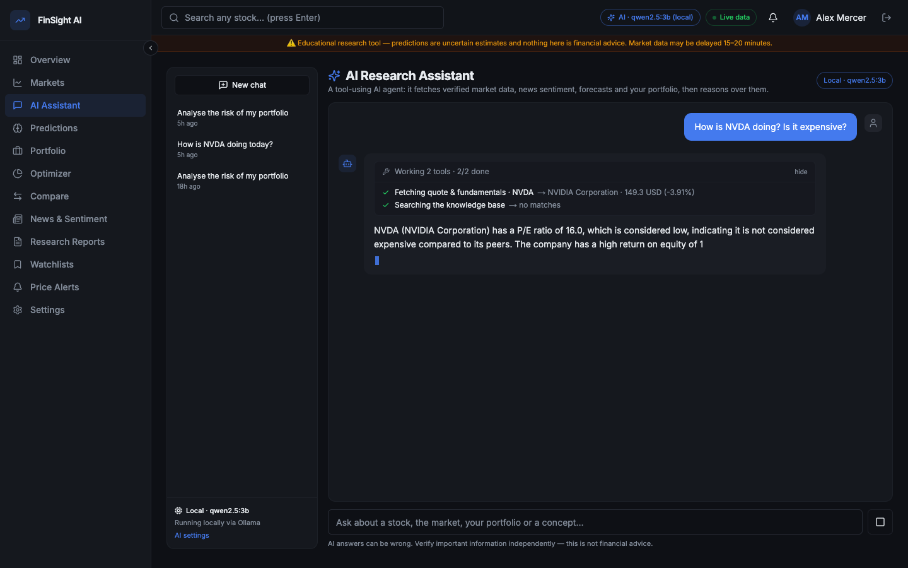
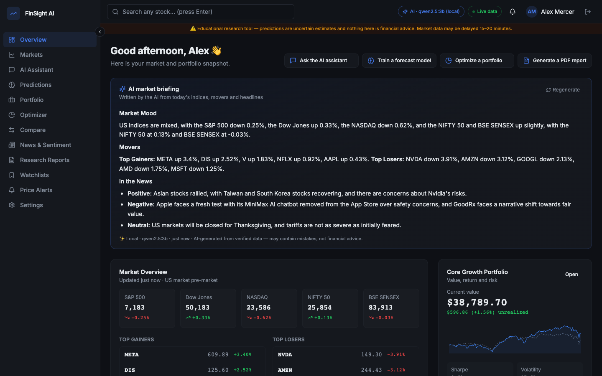
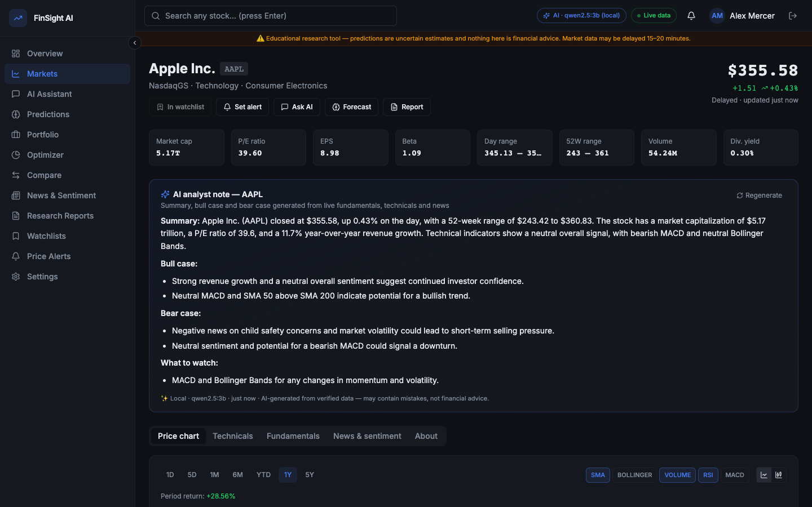
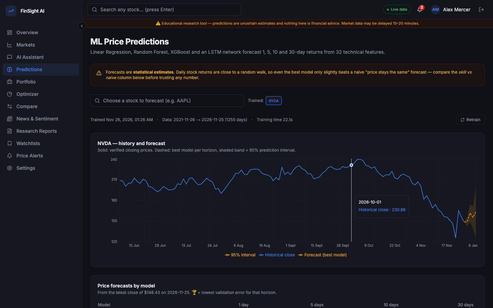
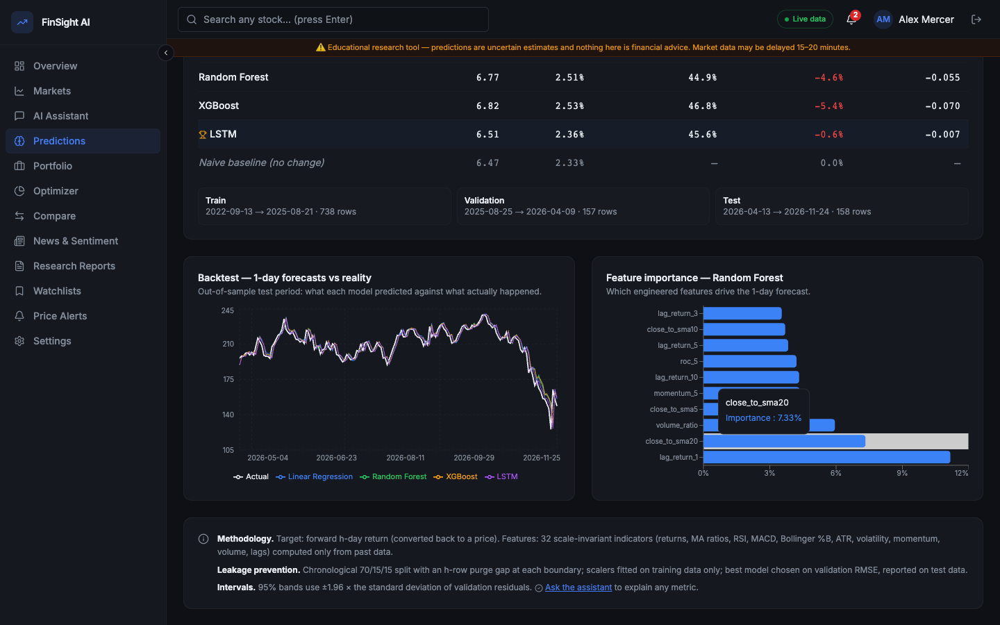
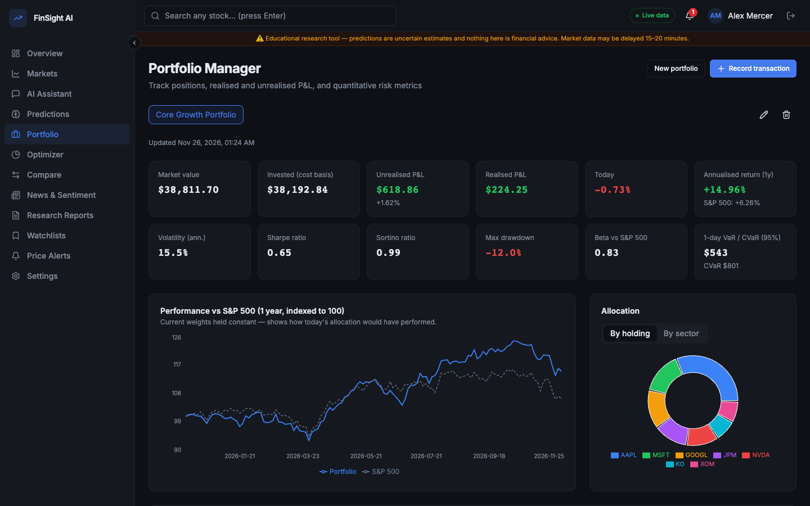
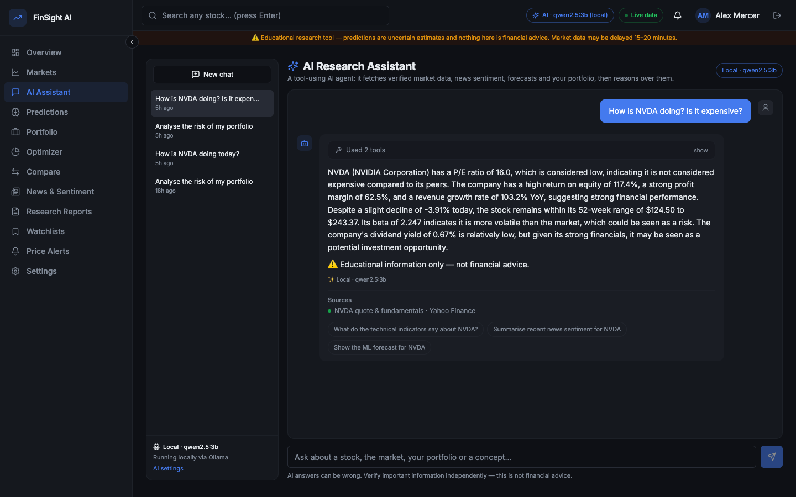

# FinSight AI 🧠📈

> **AI-powered financial intelligence & stock research platform**
> B.Tech final-year project · Computer Science & Artificial Intelligence

FinSight AI is a full-stack **AI web application** (Next.js + FastAPI) that combines a tool-calling LLM agent,
generative AI insights, retrieval-augmented generation with embeddings, transformer-based NLP (FinBERT), four
machine-learning forecasting models and quantitative portfolio analytics. The LLM runs **locally and free with
Ollama** (works offline) or in the cloud with a free Gemini/Groq key — and the app still works with no AI at all.

## 🌐 Live demo

| | |
|---|---|
| **App** | **https://finsight-ai-self.vercel.app** |
| API (Swagger docs) | https://finsight-api-ykug.onrender.com/docs |
| Demo login | `demo@finsight.ai` / `FinSight2026!` (or click **Demo Sign-in**) — or create your own account |

> The backend runs on Render's free plan: after 15 minutes without visitors it sleeps, so the **first request can take
> about a minute**. Data resets when it restarts (the demo account is recreated automatically). The online build uses
> Groq (`gpt-oss-120b`) for AI and omits the PyTorch models (LSTM, FinBERT) to fit the free 512 MB instance — run it
> locally for the full feature set.



## 🤖 The AI in FinSight

| AI capability | How it works | Where |
|---|---|---|
| **Tool-calling LLM agent** | Plans the question, fetches verified data with 8 tools (quotes, technicals, news sentiment, ML forecasts, your portfolio, market, comparisons, knowledge search), and the LLM may call more tools itself via native function calling. Every step is streamed live to the UI. | AI Assistant |
| **Streaming generative answers** | Server-Sent Events stream tool events and answer tokens; chat history gives the agent conversation memory. | AI Assistant |
| **Generative AI insights** | One-click AI-written analyst notes (bull/bear case), portfolio reviews, daily market briefings, news digests and plain-language explanations of ML results. | Overview, Stock, Portfolio, Predictions, News |
| **RAG with embeddings** | Hybrid retrieval: `nomic-embed-text` vector search + TF-IDF over a financial knowledge base, injected into the prompt. | Assistant, insights |
| **Transformer NLP** | FinBERT (ProsusAI/finbert) classifies every headline as positive / negative / neutral. | News, stock pages, reports |
| **Machine learning** | Linear Regression, Random Forest, XGBoost and an LSTM forecast returns with leakage-free evaluation. | Predictions |
| **Grounding & safety** | The LLM may only use numbers from tool results; sources are cited; disclaimers are enforced; an offline analyst answers when no LLM is available. | Everywhere |

LLM providers (switchable in **Settings → AI model**): **Ollama** (local: `qwen2.5:3b`, `qwen2.5:1.5b`, …) ·
**Google Gemini** · **Groq** · **OpenAI**. With `LLM_PROVIDER=auto` a cloud key is preferred and the local model is the fallback.

| AI market briefing | AI analyst note |
|---|---|
|  |  |

---

## ✨ Features

| Area | What it does |
|---|---|
| 📊 **Market dashboard** | Major indices (S&P 500, Dow, NASDAQ, NIFTY 50, SENSEX), top gainers / losers / most active, market status |
| 🔍 **Stock analysis** | Search any ticker (US & NSE/BSE), area **and candlestick** charts, SMA 20/50/200, Bollinger Bands, volume, RSI & MACD panels, fundamentals, company news |
| 📐 **Technical signals** | RSI (Wilder), MACD, Bollinger, golden/death cross — summarised into an overall bullish / bearish / neutral reading |
| 🤖 **ML price forecasts** | Linear Regression, Random Forest, XGBoost and a PyTorch **LSTM** forecast 1/5/10/30-day returns; background training with progress, 95 % prediction intervals, test-set metrics vs a naive baseline, backtest chart, feature importance |
| 📰 **News & sentiment** | Yahoo Finance headlines (Finnhub/NewsAPI optional) scored by **FinBERT**; per-stock and per-sector sentiment; "try the model" playground |
| 💬 **AI research assistant** | Streaming, tool-calling LLM agent with live tool steps, citations, follow-up suggestions and chat history (see *The AI in FinSight*) |
| ✨ **AI insights** | AI-written analyst notes, portfolio reviews, market briefings, news digests and model explanations embedded in the pages |
| 💼 **Portfolio manager** | Multiple portfolios, BUY/SELL ledger (average-cost), realised & unrealised P&L, Sharpe, Sortino, volatility, max drawdown, beta, **VaR & CVaR**, performance vs S&P 500, allocation by holding and sector |
| 🧮 **Portfolio optimizer** | Markowitz efficient frontier implemented with NumPy/SciPy (SLSQP), Ledoit-Wolf covariance, max-Sharpe & min-volatility portfolios, Monte Carlo cloud, whole-share allocation for a budget, correlation heatmap |
| ⚖️ **Compare** | Up to 5 stocks: normalised performance, volatility, drawdown, Sharpe, valuation & profitability, correlation |
| 📋 **Research reports** | One-click equity research report (fundamentals, technicals, sentiment, forecasts, risk) exported as a **PDF** with a vector price chart |
| 🔔 **Alerts & notifications** | Price-above/below and daily-move alerts checked in the background; in-app notifications (also for finished model training) |
| 👤 **Accounts** | JWT access/refresh tokens, bcrypt hashing, profile & preferences, change password, **working forgot/reset-password flow** |

| Predictions | Model evaluation |
|---|---|
|  |  |

| Portfolio analytics | AI assistant |
|---|---|
|  |  |

---

## 🏗️ Tech stack

| Layer | Technology |
|---|---|
| Frontend | Next.js 14 (App Router), TypeScript, Tailwind CSS, TanStack Query, Recharts, TradingView Lightweight Charts |
| Backend | Python 3.11+, FastAPI, SQLAlchemy 2 (async), Pydantic v2, PyJWT, bcrypt |
| Data | Yahoo Finance via `yfinance` (free, no key) with deterministic simulated fallback |
| ML / NLP | scikit-learn, XGBoost, PyTorch (LSTM), SciPy, FinBERT via 🤗 Transformers |
| Generative AI | Tool-calling agent with streaming (SSE); Ollama (local Qwen 2.5) or Gemini / Groq / OpenAI; hybrid RAG with `nomic-embed-text` embeddings |
| Storage | SQLite (default) or PostgreSQL 16 · in-memory cache (default) or Redis 7 |
| Reports | ReportLab (PDF) |
| DevOps | Docker Compose, Makefile, pytest (72 tests) |

---

## 🚀 Quick start (local, no Docker)

**Prerequisites:** Python 3.11+ · Node.js 18+ · Git
**macOS only:** `brew install libomp` (OpenMP runtime required by XGBoost) · optional: [Ollama](https://ollama.com) for local AI (`make ai-setup` installs it)

```bash
git clone <your-repo-url> finsight-ai && cd finsight-ai

make setup     # creates backend/.venv, installs Python + npm dependencies
make ai-setup  # installs Ollama + the local AI models (~2.2 GB, one time) — skip if you'll use a Gemini key
make seed      # creates the demo account with a sample portfolio, watchlist and alerts
make dev       # starts Ollama (if installed), backend on :8000 and frontend on :3000
```

Open **http://localhost:3000** and sign in with the demo account:

| Email | Password |
|---|---|
| `demo@finsight.ai` | `FinSight2026!` |

API docs (Swagger): **http://localhost:8000/docs**

<details>
<summary><b>Without make (Windows / manual)</b></summary>

```bash
# Backend
cd backend
python -m venv .venv
.venv\Scripts\activate            # macOS/Linux: source .venv/bin/activate
pip install -r requirements-dev.txt
python scripts/seed_db.py
uvicorn app.main:app --reload --port 8000

# Frontend (new terminal)
cd frontend
npm install
copy .env.local.example .env.local   # macOS/Linux: cp .env.local.example .env.local
npm run dev
```
</details>

### Optional configuration

Everything works without a `.env`. To enable extras, `cp .env.example .env` in the project root:

| Variable | Enables |
|---|---|
| `GOOGLE_API_KEY` / `GROQ_API_KEY` / `OPENAI_API_KEY` | A cloud LLM (stronger answers) — preferred automatically, with local Ollama as fallback |
| `OLLAMA_MODEL` | Local model to use, e.g. `qwen2.5:1.5b` for faster answers on 8 GB machines (also switchable in Settings) |
| `LLM_PROVIDER` | Force `ollama`, `gemini`, `groq`, `openai` or `offline` instead of `auto` |
| `SENTIMENT_BACKEND=lexicon` | Skip FinBERT (saves ~500 MB RAM) and use the lexicon sentiment model |
| `MARKET_DATA_MODE=demo` | Fully offline mode with simulated data (good for presentations without Wi-Fi) |
| `DATABASE_URL`, `REDIS_URL` | PostgreSQL / Redis instead of SQLite / memory |
| `SMTP_*` | Emailed password-reset links (otherwise shown on screen in development) |
| `FINNHUB_API_KEY`, `NEWS_API_KEY` | Additional news sources |

---

## 🐳 Docker (PostgreSQL + Redis)

Requires Docker with Compose v2.24+.

```bash
cp .env.example .env                                   # optional
docker compose up --build
docker compose exec backend python scripts/seed_db.py  # demo account
```

Frontend http://localhost:3000 · API http://localhost:8000/docs. (Every newly registered account also gets a starter
portfolio and watchlist, so seeding is optional.)

---

## 🧪 Testing & quality

```bash
make test      # 72 backend tests (auth, portfolio maths, ML leakage checks, optimizer, sentiment, LLM agent loop, streaming, API flows)
make lint      # ESLint + TypeScript type check
make build     # production build of the frontend
```

Tests run fully offline (simulated data, temporary SQLite database).

---

## 📁 Project structure

```
finsight-ai/
├── backend/
│   ├── app/
│   │   ├── ai/            # LLM providers, tool-calling agent, AI insights, RAG knowledge base
│   │   ├── data/          # market data layer (Yahoo Finance + simulated fallback)
│   │   ├── ml/            # indicators, features, models, evaluation, pipeline, background jobs
│   │   ├── models/        # SQLAlchemy ORM (21 tables)
│   │   ├── routers/       # FastAPI endpoints (/api/v1/...)
│   │   ├── schemas/       # Pydantic request/response models
│   │   ├── services/      # business logic (stocks, news, sentiment, portfolio, optimizer, reports, alerts)
│   │   └── utils/         # auth, cache, email
│   └── tests/             # pytest suite
├── frontend/src/
│   ├── app/               # Next.js pages: (auth) and (dashboard) route groups
│   ├── components/        # UI, charts, dashboard widgets
│   ├── hooks/ · lib/      # API client, auth hooks, formatters
├── ml_research/           # Jupyter notebooks (EDA, features, model comparison, LSTM, sentiment)
├── infrastructure/scripts # demo seeder, PostgreSQL init
└── docs/                  # architecture, API, ML methodology, deployment, implementation notes
```

---

## 🧠 How the ML works (short version)

* **Target:** forward *h*-day **return** (converted back to a price), for h ∈ {1, 5, 10, 30} trading days.
* **Features:** 32 scale-invariant indicators (returns, MA ratios, RSI, MACD, Bollinger %B, ATR, volatility, momentum, volume, lags) computed only from past data.
* **No leakage:** chronological 70/15/15 split with an *h*-row purge gap, scalers fitted on training data only, model selection on validation, metrics on the untouched test set.
* **Honest evaluation:** every model is compared with a naive "price stays the same" forecast (*skill vs naive*). On real data the skill is usually close to zero — consistent with the weak-form efficient-market hypothesis — and the UI says so.

Full details: [docs/ml_documentation.md](docs/ml_documentation.md).

---

## 🛠️ Troubleshooting

| Problem | Fix |
|---|---|
| `XGBoost Library (libxgboost.dylib) could not be loaded` | macOS: `brew install libomp`. The app still runs without it — XGBoost is just skipped. |
| Pages show **"Simulated data"** | Yahoo Finance was unreachable or rate-limited; data is simulated until it recovers (≈90 s). Check *Settings → System status*. |
| `Cannot reach the backend` toast | Start the backend (`make backend`) and check `NEXT_PUBLIC_API_URL` in `frontend/.env.local`. |
| Port already in use | `lsof -i :8000` / `lsof -i :3000` and stop the other process. |
| Assistant says "offline analyst mode" | No LLM is reachable: run `make ai-setup` / `ollama serve`, or add `GOOGLE_API_KEY` to `.env`. |
| AI answers are slow | Local models depend on RAM. Close heavy apps, switch to `qwen2.5:1.5b` in **Settings → AI model**, or add a free Gemini/Groq key. |
| "FinSight was updated — Reload" | The frontend was rebuilt while the tab was open; the page reloads itself once to pick up the new version. |
| "Something went wrong on this page" | The error and its stack trace are written to the backend terminal as `CLIENT ERROR …` — share that line when reporting a bug. |

---

## ⚠️ Disclaimer

FinSight AI is an **educational research tool** and does **not** provide financial advice. Forecasts are statistical
estimates with substantial uncertainty. Market data may be delayed 15–20 minutes.

## 📄 License

MIT — see [LICENSE](LICENSE).
