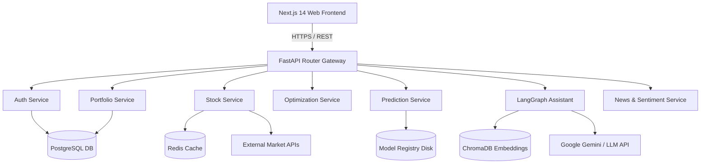

# FinSight AI — Architecture Specification

## 1. High-Level System Architecture
FinSight AI is structured into decoupled, modular tiers:
- **Presentation Tier**: Next.js 14 App Router, TypeScript, Tailwind CSS, shadcn/ui component primitives, Recharts, and TradingView Lightweight Charts.
- **API & Routing Tier**: FastAPI asynchronous application with Pydantic request/response validation, HTTPBearer JWT authentication, and dependency injection.
- **Service Tier**: Modular domain services for stock analytics (`StockService`), news retrieval and sentiment analysis (`NewsService`, `SentimentService`), portfolio accounting and risk modeling (`PortfolioService`), Markowitz optimization (`OptimizationService`), and research report synthesis (`ReportService`).
- **AI & ML Engine**:
  - Predictor pipeline with time-aware splitting, feature engineering (SMA, EMA, RSI, MACD, Bollinger Bands, ATR, momentum, lags), and 4 model architectures (Linear Regression, Random Forest, XGBoost, and PyTorch LSTM).
  - FinBERT transformer pipeline for financial domain sentiment scoring.
  - LangGraph conversational agent with semantic retrieval from ChromaDB vector store and deterministic tool calling.
- **Data & Persistence Layer**:
  - PostgreSQL 16 relational database with pgvector extension.
  - Redis 7 cache for API response caching, rate limiting, and session state.
  - Local/S3 model registry for serialized model artifacts and scalers.

