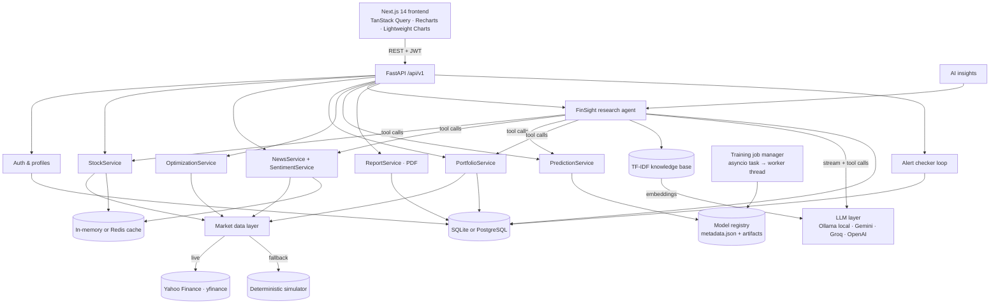

# FinSight AI — Architecture

## 1. Overview

## 2. Backend layers

| Layer | Location | Responsibility |
|---|---|---|
| Routers | `app/routers/` | HTTP endpoints, auth dependency, request validation, error mapping |
| Schemas | `app/schemas/` | Pydantic request/response contracts |
| Services | `app/services/` | Business logic; no HTTP concerns |
| Market data | `app/data/market_data.py` | Single gateway to price/fundamental/news data. Live Yahoo Finance first, simulated fallback, TTL cache, circuit breaker, async wrappers (`asyncio.to_thread`) so blocking I/O never stalls the event loop |
| ML | `app/ml/` | Indicators, feature engineering, four models, evaluation, training pipeline, background jobs |
| AI | `app/ai/` | `llm.py` provider layer (streaming, function calling, embeddings), `agent.py` tool-using agent, `insights.py` generative insight cards, `knowledge_base.py` hybrid RAG |
| Persistence | `app/models/`, `app/database.py` | SQLAlchemy 2 async ORM; JSON columns map to JSONB on PostgreSQL |

## 3. Key design decisions

* **Zero-config by default.** SQLite + in-memory cache + no API keys. PostgreSQL/Redis/LLM keys are drop-in upgrades via environment variables.
* **Graceful degradation.** Every external dependency has a fallback: live data → simulated data (flagged `is_demo` and shown as a "Simulated data" badge), FinBERT → lexicon model, LLM → offline analyst, XGBoost/PyTorch missing → model skipped with a reason.
* **No blocking on the event loop.** yfinance, model training, FinBERT inference and PDF generation run in worker threads.
* **Background work without extra infrastructure.** Training jobs are asyncio tasks (serialised by a semaphore) that run the pipeline in a thread and report progress; a periodic asyncio loop evaluates price alerts. (A Celery/Redis queue would be the next step for multi-instance deployments.)
* **Ledger-first portfolio.** Holdings are always rebuilt from the transaction ledger (average-cost method), so positions can never drift from transactions and deletions are safe.
* **Grounded AI.** The agent gathers data through tools first and the LLM is only allowed to use numbers present in the VERIFIED DATA block.

## 4. Request flow example — "How is NVDA doing?"

1. `POST /api/v1/ai/chat/stream` (Server-Sent Events) → `FinSightAgent.stream`
2. Plan: extract symbols (`NVDA`), detect intents (`overview`) — reusing earlier symbols for follow-ups
3. Tools in parallel, each streamed as `tool running → done`: `get_stock_snapshot`, `get_technical_analysis`, `get_news_sentiment`, `search_financial_knowledge` (embedding search)
4. The VERIFIED DATA context + tool schemas go to the active LLM; if it requests another tool (native function calling) the agent runs it and loops (max 2 extra rounds)
5. Answer tokens stream to the browser; the final `done` event carries sources and follow-up suggestions
6. The exchange (answer, sources, tool calls) is saved in `chat_messages` for conversation memory

## 5. Frontend

* App Router with two route groups: `(auth)` (login, register, forgot/reset password) and `(dashboard)` (guarded by a token check in the layout).
* Server state via TanStack Query (caching, polling for training status, background refetch).
* Axios client with automatic access-token refresh (single shared refresh request) and redirect to login on expiry.
* Charts: Recharts (area/line/composed/scatter/pie) and TradingView Lightweight Charts (candlesticks).
