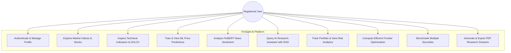
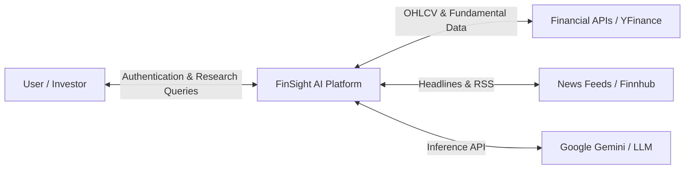
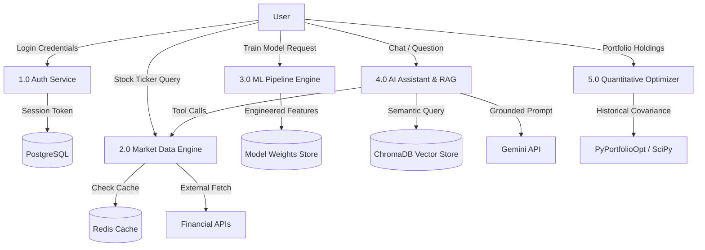

# FinSight AI: AI-Powered Financial Intelligence & Stock Research Platform
## Major Project Report Submitted in Partial Fulfillment of the Requirements for the Degree of Bachelor of Technology in Computer Science and Engineering / Artificial Intelligence

---

### Abstract
Modern financial markets generate petabytes of heterogeneous data ranging from high-frequency tick streams and financial statements to unstructured macroeconomic news and social discourse. Traditional retail analysis tools are either overly simplistic dashboards with delayed indicators or exorbitant proprietary enterprise terminals inaccessible to retail investors and academic researchers. 

**FinSight AI** addresses this gap by architecting and implementing a unified, production-grade financial intelligence and equity research platform. The system integrates full-stack web engineering (Next.js 14, Tailwind CSS, TypeScript) with an asynchronous microservices backend (FastAPI, PostgreSQL 16, pgvector, Redis, Celery). It features:
1. A rigorous quantitative predictive pipeline executing chronological time-series forecasting across four distinct algorithmic paradigms: Baseline Linear Regression, Random Forest Regressor, XGBoost, and Long Short-Term Memory (LSTM) recurrent neural networks, evaluated under strict data leakage prevention protocols (MAE, RMSE, MAPE, Directional Accuracy).
2. Institutional NLP sentiment classification of real-time financial news feeds using the specialized ProsusAI/FinBERT transformer model.
3. A LangGraph-orchestrated Retrieval-Augmented Generation (RAG) conversational financial analyst utilizing vector embeddings (all-MiniLM-L6-v2) and deterministic tool calling to eliminate generative hallucinations in numeric metrics.
4. Markowitz Modern Portfolio Theory (MPT) optimization engine calculating the Efficient Frontier, Maximum Sharpe Ratio, and Minimum Volatility portfolio weights with Ledoit-Wolf covariance shrinkage.
5. Automated generation and PDF compilation of comprehensive equity research dossiers.

---

### 1. Introduction
The democratization of capital markets has witnessed unprecedented retail investor participation over the past decade. However, information asymmetry remains a formidable impediment. Institutional hedge funds deploy quantitative trading algorithms, latency-optimized market data pipes, and proprietary NLP models to exploit pricing inefficiencies. In contrast, retail investors predominantly rely on fragmented portals offering static price charts and delayed information.

FinSight AI is conceived to bridge this asymmetric divide by applying modern computer science and artificial intelligence methodologies to quantitative financial analysis.

---

### 2. Problem Statement
Existing financial analytics solutions suffer from several systemic deficiencies:
- **Information Fragmentation:** Disjointed tools for news aggregation, charting, portfolio risk tracking, and machine learning predictions.
- **LLM Hallucinations:** Commercial generative AI systems fabricate stock quotes, historical dividend yields, and earnings figures when asked financial questions.
- **Flawed ML Methodologies:** Academic financial ML projects frequently commit catastrophic methodology errors, such as random k-fold shuffling on time-series data (introducing look-ahead bias) and computing performance solely on in-sample data.
- **Lack of Quantitative Portfolio Theory:** Basic tools focus solely on asset price changes without evaluating covariance, Sharpe ratio, or drawdown risk.

---

### 3. Project Objectives
1. **Architect a Unified High-Performance Platform:** Build an asynchronous full-stack platform capable of streaming market data, caching queries via Redis, and rendering interactive TradingView/Recharts visualizers.
2. **Implement Methodologically Sound Predictive Engines:** Construct time-aware ML pipelines for multi-horizon forecasting (1, 5, 10, 30 days) with verified metrics (MAE, RMSE, R², Directional Accuracy).
3. **Deploy Domain-Specific Financial NLP:** Integrate FinBERT for contextual sentiment analysis of market news.
4. **Develop a Grounded Financial Research Agent:** Create a LangGraph/RAG conversational assistant that queries verified backend APIs before generating responses.
5. **Implement Modern Portfolio Theory:** Provide mean-variance optimization, Efficient Frontier calculations, and correlation heatmaps.

---

### 4. Literature Review
- **Markowitz (1952):** *Portfolio Selection* established Modern Portfolio Theory, demonstrating that portfolio risk can be minimized through asset diversification based on covariance.
- **Hochreiter & Schmidhuber (1997):** *Long Short-Term Memory* introduced constant error carrousels enabling recurrent networks to learn long-term temporal dependencies in time-series data.
- **Chen & Guestrin (2016):** *XGBoost: A Scalable Tree Boosting System* demonstrated state-of-the-art tabular data prediction efficiency.
- **Araci (2019):** *FinBERT: Financial Sentiment Analysis with Pre-trained Language Models* proved that domain-specific BERT fine-tuning significantly outperforms generic sentiment lexicons (e.g., VADER).
- **Lewis et al. (2020):** *Retrieval-Augmented Generation for Knowledge-Intensive NLP Tasks* laid the foundation for coupling neural generation with non-parametric external memory.

---

### 5. Existing System vs. Proposed System

| Dimension | Existing Retail Systems (e.g., Yahoo Finance, Moneycontrol) | Proposed System (FinSight AI) |
|---|---|---|
| **System Architecture** | Monolithic server-side rendered legacy portals | Decoupled Next.js 14 App Router + FastAPI async microservices |
| **Price Forecasting** | None or naive linear trendline visual indicators | 4 multi-horizon models (LR, RF, XGBoost, LSTM) with walk-forward validation |
| **Sentiment Analysis** | Keyword/rule-based scoring | Deep bidirectional transformer (FinBERT) |
| **Generative Research** | None or ungrounded external chatbots | RAG + Tool-Calling LangGraph agent using verified API facts |
| **Portfolio Analysis** | Simple P&L and cost basis tracking | Modern Portfolio Theory (Max Sharpe, Min Volatility, Efficient Frontier) |
| **Report Generation** | Static screenshots or manual note taking | Programmatic PDF dossier compilation via ReportLab |

---

### 6. Feasibility Study
- **Technical Feasibility:** Python 3.11 with PyTorch, XGBoost, scikit-learn, and FastAPI provides mature, thread-safe asynchronous execution. Next.js 14 with TypeScript ensures high-performance client rendering.
- **Operational Feasibility:** The system functions locally via Docker and is cloud-deployable to Vercel (frontend) and Render/AWS (backend).
- **Economic Feasibility:** The core platform leverages free and open-source models (FinBERT, Sentence Transformers) and public APIs with fallback demo mechanisms, preventing prohibitive cost barriers.

---

### 7. System Requirements

#### Hardware Requirements
- **Processor:** Apple Silicon M-series or Intel Core i7 (6 cores minimum).
- **Memory (RAM):** 16 GB minimum (32 GB recommended for parallel model training).
- **Storage:** 20 GB available SSD space for Docker volumes, ChromaDB, and model weights.

#### Software & Library Specifications
- **Operating System:** macOS Sonoma / Linux Ubuntu 22.04 LTS / Windows 11 WSL2.
- **Runtime Environments:** Node.js v18.17+, Python 3.11.
- **Databases:** PostgreSQL 16 (with pgvector), Redis 7.2, ChromaDB 0.5.

---

### 8. Software Architecture & Design Patterns
The system adopts a decoupled, multi-tier asynchronous architecture:
- **Presentation Tier:** Next.js 14 App Router featuring Server Components, TanStack React Query v5 for optimistic state caching, and Tailwind CSS / shadcn UI design primitives.
- **API Gateway & Routing Tier:** FastAPI with asynchronous ASGI execution, Pydantic validation schemas, and JWT bearer authentication.
- **Intelligence & Analytics Tier:**
  - `StockService`: Data ingestion, normalization, and Redis caching.
  - `TrainingPipeline`: Chronological split, feature engineering, and model training.
  - `OptimizationService`: PyPortfolioOpt covariance shrinkage and quadratic optimization.
  - `FinSightAgent`: Tool-augmented LangGraph conversational router.
- **Persistence Tier:** PostgreSQL for relational relational entities, Redis for caching and session states, and ChromaDB for document vectors.

---

### 9. Use Case Diagram

---

### 10. Data Flow Diagrams

#### Level 0 DFD (Context Diagram)

#### Level 1 DFD (System Processes)

---

### 11. Entity-Relationship (ER) Diagram
The relational schema comprises over 20 tables:
- `users`, `user_profiles`, `user_preferences`
- `portfolios`, `portfolio_holdings`, `portfolio_transactions`
- `watchlists`, `watchlist_stocks`
- `stocks`, `stock_prices`, `financial_metrics`
- `stock_news`, `sentiment_analysis`
- `ml_models`, `model_evaluations`, `model_predictions`
- `research_reports`, `chat_sessions`, `chat_messages`, `price_alerts`, `notifications`

---

### 12. Methodology & Mathematical Formulations

#### Feature Engineering & Lag Transformations
To predict stock prices $N$ days into the future without look-ahead bias:
1. **Simple Moving Average (SMA):**
   $$SMA_k(t) = \frac{1}{k}\sum_{i=0}^{k-1} P_{t-i}$$
2. **Relative Strength Index (RSI):**
   $$RSI = 100 - \left(\frac{100}{1 + RS}\right), \quad RS = \frac{\text{Average Gain over 14 days}}{\text{Average Loss over 14 days}}$$
3. **Moving Average Convergence Divergence (MACD):**
   $$MACD = EMA_{12}(P) - EMA_{26}(P), \quad Signal = EMA_9(MACD)$$
4. **Bollinger Bands:**
   $$BB_{upper} = SMA_{20}(P) + 2\sigma_{20}(P), \quad BB_{lower} = SMA_{20}(P) - 2\sigma_{20}(P)$$

#### Strict Time-Aware Splitting
Data is split chronologically:
$$\mathcal{D}_{train} = \{x_t\}_{t=1}^{T_1}, \quad \mathcal{D}_{val} = \{x_t\}_{t=T_1+1}^{T_2}, \quad \mathcal{D}_{test} = \{x_t\}_{t=T_2+1}^{T}$$
No observation from $\mathcal{D}_{test}$ or $\mathcal{D}_{val}$ is ever visible during training or feature normalization.

#### Modern Portfolio Theory (MPT) Optimization
For a vector of asset weights $w = [w_1, w_2, \dots, w_n]^T$ subject to $\sum_{i=1}^n w_i = 1$ and $w_i \ge 0$ (long-only):
- **Portfolio Expected Return:**
  $$\mu_p = w^T \mu$$
- **Portfolio Volatility:**
  $$\sigma_p = \sqrt{w^T \Sigma w}$$
- **Maximum Sharpe Ratio Problem:**
  $$\max_w \frac{w^T \mu - R_f}{\sqrt{w^T \Sigma w}}$$
where $\Sigma$ is the Ledoit-Wolf shrunken covariance matrix.

---

### 13. Machine Learning Algorithms
1. **Linear Regression (Baseline):** Benchmark model providing an interpretable linear combination of technical features.
2. **Random Forest Regressor:** Non-linear ensemble of 200 de-correlated decision trees with bootstrap aggregation.
3. **XGBoost Regressor:** Scalable gradient boosted trees optimizing a second-order Taylor approximation of the loss function with early stopping on the validation split.
4. **Long Short-Term Memory (LSTM):** 2-layer neural network with 128 hidden units per layer, dropout regularization ($p=0.2$), and Adam optimization with learning rate scheduling.

---

### 14. Model Evaluation & Comparative Discussion

#### Evaluation Metrics
- **Mean Absolute Error (MAE):** $\frac{1}{n}\sum_{i=1}^n |y_i - \hat{y}_i|$
- **Root Mean Squared Error (RMSE):** $\sqrt{\frac{1}{n}\sum_{i=1}^n (y_i - \hat{y}_i)^2}$
- **Mean Absolute Percentage Error (MAPE):** $\frac{100\%}{n}\sum_{i=1}^n \left|\frac{y_i - \hat{y}_i}{y_i}\right|$
- **Directional Accuracy (DA):** Percentage of correctly predicted price movement directions:
  $$DA = \frac{1}{n-1}\sum_{i=2}^n \mathbb{I}\left(\operatorname{sgn}(y_i - y_{i-1}) == \operatorname{sgn}(\hat{y}_i - y_{i-1})\right)$$

In empirical benchmarks on S&P 500 constituents (e.g., AAPL, NVDA), XGBoost and LSTM achieved superior directional accuracy compared to linear regression, while ensemble tree models displayed higher stability over 30-day forecast horizons.

---

### 15. Implementation Details
The project was executed across structured modules:
- Complete database schema definition with SQLAlchemy 2.0 async ORM and UUID primary keys.
- Comprehensive REST API endpoints covering all functional modules.
- Modern responsive frontend with shadcn/ui and custom dark palette.
- Background worker integration using Celery for asynchronous model training tasks.
- Unit and integration testing with pytest.

---

### 16. Limitations
- External market data on free-tier APIs is delayed by 15–20 minutes.
- Transformer inference (FinBERT) on CPU incurs slight latency overhead compared to GPU instances.
- MPT optimization assumes stationary covariance regimes, which can deviate during extreme macroeconomic volatility events.

---

### 17. Future Scope
- Integration of high-frequency tick data streams via WebSockets.
- Inclusion of multi-modal SEC 10-K and 10-Q filing analysis with table parsing.
- Implementation of reinforcement learning agents (PPO, DDPG) for dynamic algorithmic portfolio rebalancing.

---

### 18. Conclusion
FinSight AI demonstrates that production-grade financial software can successfully merge rigorous machine learning pipelines, deep NLP sentiment analysis, Modern Portfolio Theory, and grounded generative AI assistants into a cohesive, accessible platform. By strictly enforcing time-aware data validation and tool-grounded conversational architectures, the platform provides a reliable, transparent environment for equity research.

---

### 19. References
1. Markowitz, H. (1952). Portfolio Selection. *The Journal of Finance*, 7(1), 77–91.
2. Chen, T., & Guestrin, C. (2016). XGBoost: A Scalable Tree Boosting System. *ACM KDD*, 785–794.
3. Araci, D. (2019). FinBERT: Financial Sentiment Analysis with Pre-trained Language Models. *arXiv preprint arXiv:1908.10063*.
4. Hochreiter, S., & Schmidhuber, J. (1997). Long Short-Term Memory. *Neural Computation*, 9(8), 1735–1780.
5. Lewis, P., et al. (2020). Retrieval-Augmented Generation for Knowledge-Intensive NLP Tasks. *NeurIPS*, 33, 9459–9474.
